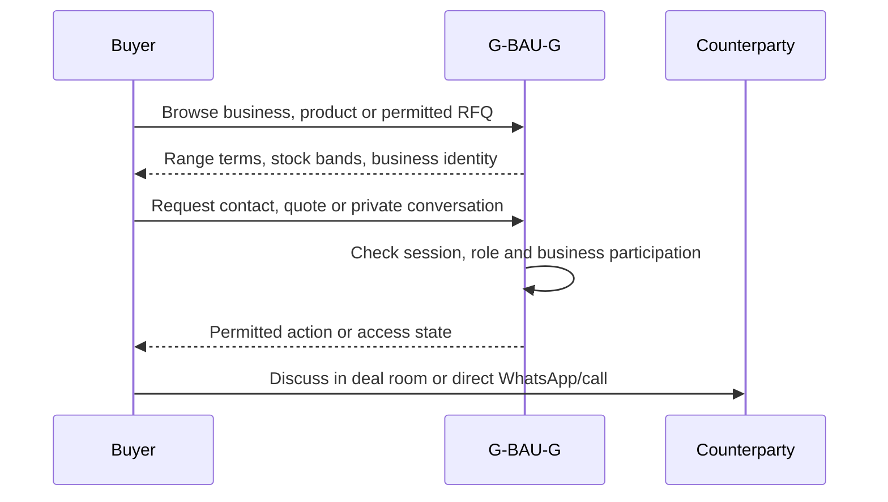
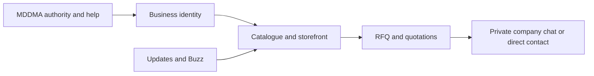

# Vision & Pitch

> **v3.3 · Documentation reviewed 17 October 2026.** Current source and selected hosted schema, policies, settings and buckets were checked. This is not a full security audit, legal approval or device-delivery certification.

## Thesis

G-BAU-G structures business identity, discovery and trade communication while protecting pricing power. It is operated by **MDDMA**, not an anonymous public price-comparison marketplace. Current network onboarding includes Indian and overseas food-trade businesses; Association affiliation remains separate from platform verification.

## The problem

Phone calls, screenshots and broker memory fragment trust and demand signals. Exact-price comparison erodes margins; unclear business identities waste enquiry time; notices and sourcing intent disappear in private chats.

## The solution: controlled transparency

Show enough to initiate a serious conversation, not enough to expose exact commodity price or stock. Products use price ranges, stock bands and demand trends. Contact/quotation/chat access is checked separately from browsing. No verified badge guarantees solvency or fulfilment.

## Four connected surfaces

1. **Discovery:** verified business directory, storefronts, brands and catalogue.
2. **Daily community:** Updates/Buzz/Following/Bulletin, text/media/polls, threaded replies, likes, reposts, saves and simplified sharing.
3. **Commercial intent:** RFQ listings, private indicative/formal quotations and deal-room conversations; not the removed multi-item cart.
4. **Authority and help:** Discover, About, Knowledge, FAQ, Contact and Install; public legal pages still need counsel review/publication.

## Business model: separate the proposal from the app

The retained commercial baseline is Free and **₹10,000/year Paid**, broker same fee/no addon (BIZ-002/003). Historical revenue assumptions at that rate are **projections**, not achieved sales:

| Projection | Paid members | Annual gross revenue |
|---|---:|---:|
| Year 1 | 40 | ₹4.0 lakh |
| Year 2 | 120 | ₹12.0 lakh |
| Year 3 | 250 | ₹25.0 lakh |

The 40-member break-even statement is a historical planning assumption requiring updated cost validation. Current `/membership` describes account/business identity; `/apply` submits a pending business. Payment helpers are disabled and the hosted membership table is absent. Monetisation is being designed independently of verification; no new price or binding offer is created here.

## Success signals

Business activation, permitted contact reveals, RFQ/quote responses, meaningful private conversations, repeat feed participation and install adoption are useful measures. Do not confuse optimistic buttons with saved activity, realtime badges with delivered push, or planned pilot thresholds with measured results. Pilot target: 8–10 sellers plus 8–10 buyers for 90 days; actual status unverified.

## Explicit omissions

No Lead Packs/pay-per-lead, Silver/Gold/Platinum, separate broker addon, exact-price comparison, WhatsApp Business API, in-app escrow or native app build. `wa.me` links are allowed. Legacy RFQ cart/inbox remains removed. New private quotations/chat are current additions, not a restoration of the old cart.

Read next: 02 Business & Scope; 03 Product & UX; 11 Decisions Log for retained constraints and historical supersessions.
