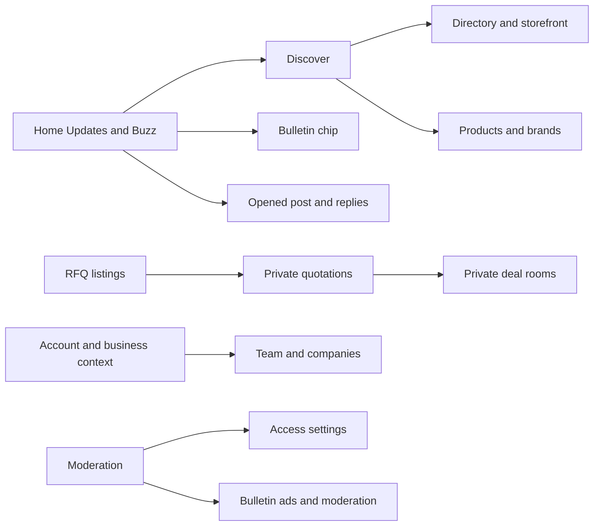

# Functional Spec

> **v3.3 · Documentation reviewed 17 October 2026.** Current source and selected hosted schema, policies, settings and buckets were checked. This is not a full security audit, legal approval or device-delivery certification.

## Module map

## Discovery and identity

| Module | Data/behavior | Acceptance check |
|---|---|---|
| Directory/profile/storefront | Safe live business projection, location/categories/trust state; no sample members merged | Approved visible row appears; private contact fields are not in broad list reads |
| Products/variants | Company catalogue, range prices, stock bands, images/gallery/video | No exact commodity price/stock rendered; three gallery extras plus cover |
| Brands | Active house-brand discovery, owner storefront and external retail link | Empty product state remains usable; no retail cart |
| Business registration | `/apply` creates hidden pending company with local identity/licence/capability fields | Real signed-in submission read back; not a membership payment |
| Team/business switch | Company context and owner/admin/editor/viewer roles | Check actual representative permissions, not simulated platform role |

## Home feed and media

`community_posts.channel` splits Updates and Buzz. Following uses followed users/businesses; Bulletin interleaves circulars. `/market/:postId` remains detail; old indexes redirect. Sources include comments, likes, views, reposts, bookmarks, polls/votes and anonymous identity audit.

Composer: text, Update/Buzz destination, images/paste, PDF, video, poll, range signal/link preview and anonymous context. Feed limits: **5MB/image**, **four images**, **10MB PDF**, **50MB video** (MP4/MOV/WebM). `community-media` is private with signed delivery; opaque UUID paths do not reveal author IDs. Client limits are not server bucket caps.

Social action order is equal-width comment/share/like/repost/save. Views only on opened posts. Native/copy/WhatsApp share; repost read-back and You reposted; Replying-to context; safe author RPC and flattened thread display. Direct anonymous-row reads are author/admin restricted; do not promise public anonymous-body visibility without a checked sanitised read path.

**Acceptance:** signed-in post → open → reply/reply-to-reply → repost → saved read-back. Test business and person Following. Guests remain read-only. Inspect real request failures, anonymous author/media paths, empty/error states and mobile keyboard behavior.

## RFQ, quotations and chat

- `/rfq`: authenticated non-hidden network listing reads; buy/sell range terms and 1–90-day expiry. Hosted writes require a verified approved visible business and representative (or applicable admin exception).
- `/quotes`: indicative/formal quotations, sender/recipient, currency, quantity/price ranges, delivery/payment terms, notes, validity/status/version. Participant-private reads; verified owner sender; withdraw RPC.
- `/messages`: private company rooms with general/RFQ/quotation/product context and messages. Session + participant/representative validation; RPC start/send, no open chat-table mutation.
- Contact reveal uses `get_company_whatsapp` and `rfq_contact_reveals`; helper currently explicitly checks Paid/Broker/Admin.
- Legacy `rfqs`, `inquiry_products`, `rfq_responses`, CartContext/CartFab/CartDrawer/RFQModal and `/account/rfqs` remain removed.

**Acceptance:** real approved business creates listing; authorised counterparty sends quote; permitted participant reads it and starts/sends/reads chat; outsider cannot read private quote/chat. Record the exact gate if open settings do not grant the action.

## Bulletin, ads and admin

Moderation tabs: **Access · Companies · Products · Users · Circulars · Ads · Categories · Community · Anon Log · RFQs**. Current Companies rows have Verify/Unverify and Hide/Unhide, not a complete approve/reject/evidence-upload workflow. Circulars has compose/Publish/Unpublish/Delete; Community moderates current posts; RFQ supports hide/expire, not read-only analytics.

Bulletin text is public when published; private attachments require authenticated published-reference/admin signing, **one-hour** URLs. Composer allows five attachments, PDFs 25MB/images 10MB. No `/circulars/:slug` route currently handles detail. Guests may read Bulletin text without access to attachments.

Ads are admin-uploaded public creatives, with placements, priority, dates, primary/mobile images and ratio/focal settings. Keep existing slot size; letterbox off-ratio creative; no bottom title/footer strip. Active/date behavior is based on stored dates and reader filtering, not a guaranteed exact local-midnight event.

Both Access settings were true on 17 October 2026; actual RFQ/quote/contact checks retain narrower rules. Admin tools never unlock for guests. **Acceptance:** change one permitted UI control, read it back and verify public/draft visibility under real sessions; do not infer hosted gates from switch labels.

## Notifications and PWA

Notifications/preferences/subscriptions have owner scope. Triggers/server delivery support social/trade/content activity; realtime bell updates are separate from push. `/sw.js` is generated with push handler script imported. Chrome/Edge native prompt when eligible; iOS manual home-screen install; supported installed-device push needs permission and valid subscription. Preview/localhost intentionally block worker/push registration.

**Acceptance:** history/badge read-back, preference changes, actual supported-device notification delivery and OS sound behavior; don't substitute a realtime badge for device proof. Geometry tests cover shared mobile rules, not all physical-device behavior.

## Public pages, SEO and unresolved gates

About/Knowledge/FAQ/Contact/Install/Discover and onboarding explain authority and identity. FAQ JSON-LD is generated from its page data; Knowledge is markdown-backed. `/forms` has Advertise/Submit Circular, not Verification Request.

Public-policy routes `/privacy`, `/terms`, `/refund`, `/grievance` are absent; policies remain internal drafts. Legal publication must precede live Razorpay. Payment management is disabled. `scripts/generate-sitemap.ts` and `prerender-public.ts` retain old home/circular/paid-plan content and do not mirror all current authority pages; **prerender/SEO parity is unverified and known stale**, not fixed in this documentation-only task.

Read next: 05 Architecture; 15 Security; 23 Verification; 26 Retention.
