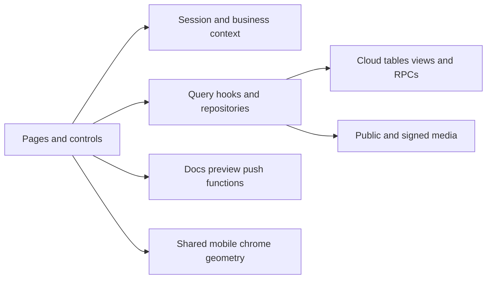

# Architecture & Tech

> **v3.3 · Documentation reviewed 17 October 2026.** Current source and selected hosted schema, policies, settings and buckets were checked. This is not a full security audit, legal approval or device-delivery certification.

## Stack and source authority

React 18, Vite, TypeScript, React Router/BrowserRouter, Tailwind/shadcn semantic HSL tokens, TanStack Query and **Lovable Cloud** Auth/Postgres/Storage/Edge Functions. Exact dependency versions belong to the package lock, not stale version claims. White/ink UI, burgundy primary, gold accents; Inter Variable/Inter/system sans stack. No rewrite-file/router migration is introduced here.

## Providers and layering

QueryClient → Tooltip → BrowserRouter → Auth → Role → ChromeVisibility → DocAuth. Routes are lazy-loaded in `src/routes.tsx`; no CartProvider. Query hooks/repositories own most data flows; some pages/components still use direct Cloud calls, so a blanket “pages never query directly” claim is not accurate.

`dataSource.ts` projects live database rows only. Discovery uses safe `companies_public`; own business details use scoped helpers such as `get_my_company`. No broad company contact/GST list export.

## Current data model

| Domain | Entities |
|---|---|
| Identity/business | profiles, user_roles, companies, companies_public, company_members, app_settings |
| Catalogue | products, product_variants, product_categories, brands |
| Feed | community_posts, post_comments (parent_id), post_likes/views/reposts/bookmarks, polls/options/votes, follows, anonymous_identity_log |
| Commercial | rfq_listings, rfq_quotations, rfq_contact_reveals, deal_rooms, deal_messages |
| Content/signals | circulars, advertisements, market_signals, analyst_reports; legacy entities may remain |
| Delivery | notifications, notification_preferences, push_subscriptions |

Hosted membership/cart RFQ tables are absent. Current membership management helpers are disabled; retained Razorpay files require restoration/review before becoming runnable. BIL remains external-service architecture **proposed**, not a verified running inference/ingest path.

## Authentication and access

Protected sessions guard account/team/quote/chat routes, data policies guard actual reads/writes. Roles live in protected `user_roles`; company-team roles are separate. Demo role is in-memory signed-out presentation, not a server privilege.

`get_public_profiles` returns safe names/avatars/company/tier to authenticated callers; private profiles stay restricted. Anonymous identity must not be passed into ordinary enrichment. Social RPCs own mutations/summary reads; thread display flattens deeper replies under a root.

Both hosted access flags were true on 17 October 2026, but **not all policies consult them**. RFQ read remains authenticated; RFQ/quote writes require verified/approved/visible business; contact helper retains Paid/Broker/Admin. RLS + grants + RPC execute permissions + guard triggers all matter; no frontend `isEffectivePaid` boolean is sufficient enforcement.

## Media and functions

Six buckets: four public display buckets (avatar/company/product/ad) and private community/Bulletin buckets. Private media uses one-hour signed delivery; community opaque UUID paths protect author identity. Catalogue helper: image 10MB/video 100MB; Bulletin PDF 25MB. Feed helper: image 5MB, four images, PDF 10MB, video 50MB. These are frontend limits; hosted bucket size/MIME configuration was unset in this review. No KYC bucket exists.

Seven source functions: verify-doc-password, get-internal-doc, fetch-link-preview, push-vapid-key, send-push, two retained Razorpay functions. Auth/secret/signature validation is function-specific; do not claim every function is public or protected by one identical gateway setting. Internal docs compile to generated `content.ts`; rebuild/deploy after source edits.

## PWA and notifications

`vite-plugin-pwa` generateSW outputs `/sw.js`, imports `/push-sw.js`, and registration is guarded against preview/localhost. Notification triggers/server hook, realtime badge and device Web Push are distinct. Install prompt depends on browser eligibility; iOS uses manual install. Permissions, subscription/VAPID/server hook and OS settings determine device delivery/sound. Unique realtime channel names avoid adding callbacks after subscribe.

## SEO, documentation and future systems

Public authority versus transactional noindex remains the design direction. Current sitemap/prerender scripts retain outdated home/circular/payment prose and don't cover every current authority page; do not certify static/render parity from their mere existence. `/circulars` index redirects; `/market/:postId` remains active. No public legal routes are shipped yet.

The full docs UI is password-gated. Seven public-marked bodies are bundled; 22 internal are only returned after per-request server password check. Vault state/password stays in React memory. Legal drafts, retention targets, future BIL and unsigned SLA are not assertions of implemented compliance.

Read next: 07 Database; 08 Functions; 09 Frontend; 15 Security; 16 Media.
