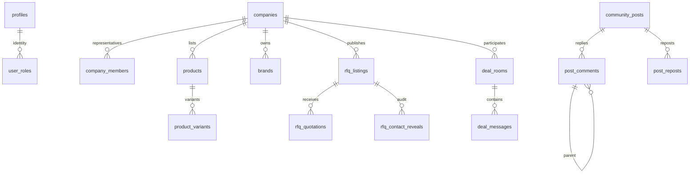

# Database Reference

> **v3.3 · Documentation reviewed 17 October 2026.** Current source and selected hosted schema, policies, settings and buckets were checked. This is not a full security audit, legal approval or device-delivery certification.

## Scope and authority

This is the current schema map, not a database backup. Rebuild from reviewed migrations and hosted-schema inspection, not prose alone. The hosted database contains **38 public-schema tables/views** in this review; `memberships`, `rfqs`, `inquiry_products` and `rfq_responses` are absent. The generated client types are a useful column reference, but deploy-time inspection wins when source and hosted state differ.

## Current entities

## Identity, membership and businesses

| Entity | Important fields / responsibilities | Access model |
|---|---|---|
| `profiles` | `id`, `full_name`, `avatar_url`, `company_name`, `phone`, `verification_tier`, trust timestamps, `is_broker`, `is_muted`, reputation fields | Private self/admin profile; display-only lookup via `get_public_profiles` |
| `user_roles` | User UUID + `app_role`; unique user/role combination | Protected role grants; never use editable profile metadata for privileges |
| `companies` | `owner_id`, name/slug, city/country, business identifiers, review/visibility/verification, assets/categories | Owner/admin management; public safe-column discovery |
| `companies_public` | Safe projection consumed by directory/storefront/quote context | No broad `select('*')` of company contact columns for discovery |
| `company_members` | company/user UUID, role (`owner`, `admin`, `editor`, `viewer`) | Peer visibility and role-specific management; business admins cannot manage another owner's row |
| `app_settings` | Key/value rows: `features_open_to_all`, `verification_open_to_all` | Settings are not a public configuration dump; helpers return appropriate booleans |

Platform roles: `admin`, `broker`, `paid_member`, `free_member`. Guest is a UI state, not an enum value. The Paid/Free exclusivity trigger remains separate from business-team roles. Multiple business/team surfaces exist at `/account/companies` and `/account/team`; do not assume every user has exactly one company in the data model.

## Catalogue and content

| Entity | Responsibilities |
|---|---|
| `products`, `product_variants` | Company catalogue, images/gallery/video, grade/packaging, price ranges, stock bands, trend fields |
| `product_categories` | Active/featured taxonomy, aliases and ordering |
| `brands` | Company house brands and external retail links |
| `advertisements` | Placement, creative, optional mobile creative, active dates and priority |
| `circulars` | Bulletin title/body, publication status, attachment references |
| `market_signals`, `analyst_reports` | Current signal/report repositories; do not imply a deployed BIL inference engine |
| `market_news`, `humor_posts`, `posts`, `comments` | Retained legacy entities; old standalone News/Humor/Discourse screens are not the active home feed |

Gallery limit: three additional product images plus cover. Trade-price display uses ranges; exact stock remains hidden. Membership fee amounts are not commodity-price disclosure.

## Social and notification entities

- `community_posts`: `channel` (`updates` / `buzz`), content/media/structured data, author, anonymity, hidden/pinned state and timestamps.
- `post_comments`: content and `parent_id`; display groups deeper replies under the top-level ancestor.
- `post_likes`, `post_views`, `post_reposts`, `post_bookmarks`: interaction persistence. Aggregates and mutation RPCs prevent broad exposure of personal activity.
- `post_polls`, `post_poll_options`, `post_poll_votes`: polls and votes.
- `follows`: business and person targets; Following reads the appropriate followed companies/users.
- `anonymous_identity_log`: restricted compliance identity mapping.
- `notifications`, `notification_preferences`, `push_subscriptions`: owner-scoped notification history, preferences and delivery subscriptions. Push endpoint/key material is not public profile data.

`get_public_profiles(_ids uuid[])` returns only id, name, avatar, company name and verification tier, and requires a signed-in caller. An absent profile or failed lookup may still produce a fallback label; anonymous identities must not be enriched for ordinary readers.

## RFQ, quotations and deal rooms

`rfq_listings` columns checked in the hosted schema: id, company_id, posted_by, listing_type, commodity, quantity_min/max/unit, price_min/max/unit, valid_until, grade_variety, origin_country, delivery_location, is_hidden, timestamps, currency, packaging, notes and status.

- `rfq_listings`: buy/sell intent, range terms and 1–90-day expiry. Hosted SELECT is **authenticated-only** for non-hidden rows (admin exception). INSERT requires admin or a verified, approved, visible company with an authorised owner/editor/admin representative; the two open-access settings do **not** appear in this policy.
- `rfq_quotations`: sender user/company, recipient company, RFQ, indicative/formal kind, currency, quantity/price ranges, delivery/payment terms, notes, validity, status and version. Sender must own a verified/approved/visible company and target an open, current listing. Reads are sender user, recipient company owner or platform admin. Withdrawal uses `withdraw_my_rfq_quotation`; no generic client UPDATE.
- `rfq_contact_reveals`: logged contact reveals. `get_company_whatsapp` still explicitly checks Paid/Broker/Admin, independent of open-access settings.
- `deal_rooms`: company pair, subject, context (`general`, `rfq`, `quotation`, `product`), related IDs, open/archived state and message timestamps.
- `deal_messages`: room, sender user/company, body, created time. Mutations use `start_deal_room` and `send_deal_message`; room access uses `can_access_deal_room` for owners and owner/admin/editor representatives (or platform-admin read policy).

## Important helpers and safety boundaries

`has_role`, `has_company_role`, `is_features_open`, `is_verification_open`, `is_paid_or_admin`, `get_public_profiles`, `get_company_whatsapp`, `can_access_deal_room`, comment/like/repost/poll/follow RPCs and trust-field guard triggers are distinct controls. A permissive helper does not automatically override a policy that does not call it.

`is_paid_or_admin` in the hosted review requires a non-null user plus open features or Paid/Broker/Admin. Both access settings were **true on 17 October 2026**; that is a dated snapshot, not a promise that every action is available.

Every new application table needs explicit grants and RLS. Managed Auth/Storage schemas are not app-owned. User IDs should be plain UUIDs or references to public profiles; only profiles/user_roles may reference managed auth users with cascade semantics.

## Storage

Six hosted buckets: public `avatars`, `company-assets`, `product-images`, `ad-assets`; private `community-media`, `circular-assets`. Hosted bucket MIME/size configuration is unset in this review; client validation is not a server-enforced upload limit. See doc 16 for paths, signing and exact client limits.

## Recovery and inspection

Use the hosted schema, migrations, types and a verified restore drill. Retention automation and payment activation are not established by a table inventory. Doc 15 covers access boundaries; doc 26 covers proposed retention and unresolved mapping decisions.
