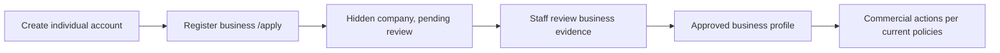

# Money & Membership

> **v3.3 · Documentation reviewed 17 October 2026.** Current source and selected hosted schema, policies, settings and buckets were checked. This is not a full security audit, legal approval or device-delivery certification.

## Current commercial state

Separate **account identity**, **business verification**, **MDDMA Association affiliation** and **future commercial packaging**. Current `/membership` explains individual-account versus verified-business access; it does not sell a priced checkout. `/apply` registers a business for review.

The older locked commercial baseline remains Free / ₹10,000 per year Paid, broker at the same fee with no addon (BIZ-002/003). `tierLabel`/`tierPriceInr` still return Paid Membership / ₹10,000 for legacy tier values. This is a retained baseline and compatibility helper, **not an active offer or operational payment subscription**. Reconcile future packaging through a committee decision rather than inventing a new plan here.

## Current application flow

Application fields: legal/trading name, description, city/country, phone/email/website, local tax/business registration ID, food-business licence and capabilities/categories; broker checkbox adds a capability. Legacy `gstin`/`fssai` columns temporarily carry jurisdiction-neutral evidence. It does **not** self-promote a profile broker privilege or create a pending membership row. Indian and overseas food businesses may apply; don't present MDDMA affiliation as identical to platform verification.

## What has been removed or disabled

Hosted `memberships` is absent. In `src/lib/membership.ts`:

- `listMembershipsByStatus` returns `[]`.
- `createPaymentLinkForMembership` returns no URL and a disabled-payment error.
- `manuallyActivateMembership` and `cancelMembership` return table-removed errors.
- Static labels, INR formatting, active/expiry helpers and admin bypass remain.

Retained Razorpay function files reference the removed schema/activation RPC. They are historical integration code, not a working checkout. There is no usable payment queue, automatic annual renewal, founding-lock implementation, or confirmed refund button in the current app. Never say a duplicate webhook is safe without testing the restored activation path.

## Roles, business access and overrides

Platform enum: admin / broker / paid_member / free_member; guest has no role row. Protected role grants are independent of team roles owner/admin/editor/viewer. The Paid/Free exclusivity invariant remains: inserting Paid/Broker removes Free; authorised downgrade restores it.

Hosted settings were both **ON on 17 October 2026**:
- Feature Access affects callers/policies that use `is_features_open` / `is_paid_or_admin`.
- Verification not required affects paths that use `is_verification_open`.

They do not override every commercial check: RFQ insertion/quotations still require approved, visible, verified businesses; RFQ reads require login; `get_company_whatsapp` explicitly checks Paid/Broker/Admin. Admin controls remain privileged. This drift is documented, not changed by a documentation-only refresh.

## Verification and reputation

`profiles.verification_tier`: unverified → email → company → gst. Company verification/visibility/review state is separate. Admin trust-field edits are guarded; no self-serve `/account/verify` or KYC upload bucket exists. See doc 23 for proposed evidence/retention commitments.

Buyer-reputation fields and badge mappings exist, but automated BIL scoring remains planned. Do not equate manual verification with a calculated creditworthiness guarantee. Broker capability adds no separate fee and does not imply authority to grant platform roles.

## Before payments return

1. Record approved packaging and compatibility with BIZ-002/003.
2. Publish counsel-reviewed Privacy/Terms/Refund/Grievance pages (LEGAL-001).
3. Restore and review membership/payment schema, grants, role activation and cancellation behavior.
4. Test amount/currency, signature validation, duplicate/out-of-order events, expiry and cancelled states.
5. Run a complete test-mode payment and read back the resulting account/role state.
6. Only then approve live keys and communicate prices/refund terms.

Refund windows, fees, SLA and founding promises in docs 21/24 are **draft contractual terms**, not software automation or legal sign-off. This refresh does not alter their numeric commitments.
